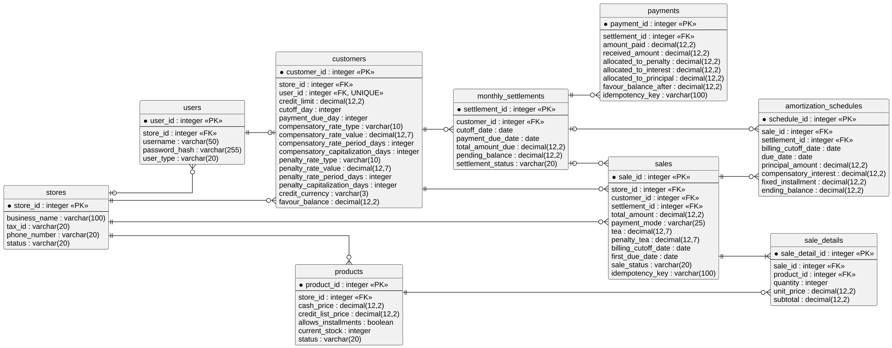

# Proximity Credit database

The diagram shows the PostgreSQL entities used by the Docker stack and the main keys and contract fields. The Flyway baseline in the backend repository defines the full schema.

- Both customer rates retain their original decimal fraction and reference period. Capitalization is present only for a nominal rate.
- Product installment eligibility is stored in `allows_installments`. The system operates in PEN.
- A month-end sale links to its settlement once billed. Installment sales link through their individual schedule rows.
- A payment records the amount received, the amount allocated to the debt and the resulting credit balance.

